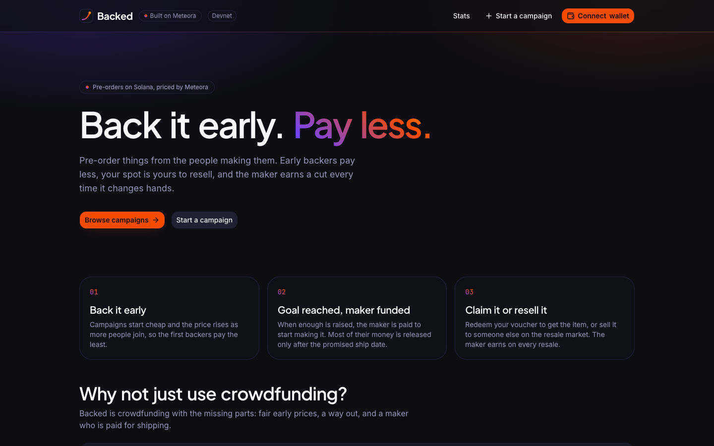
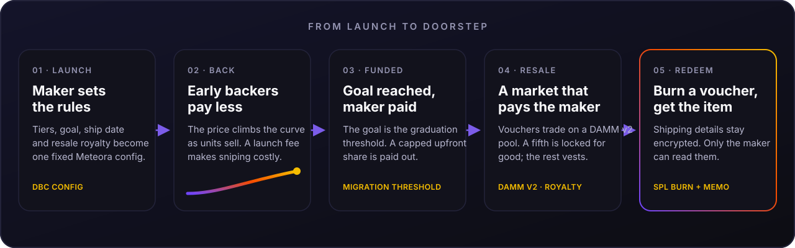
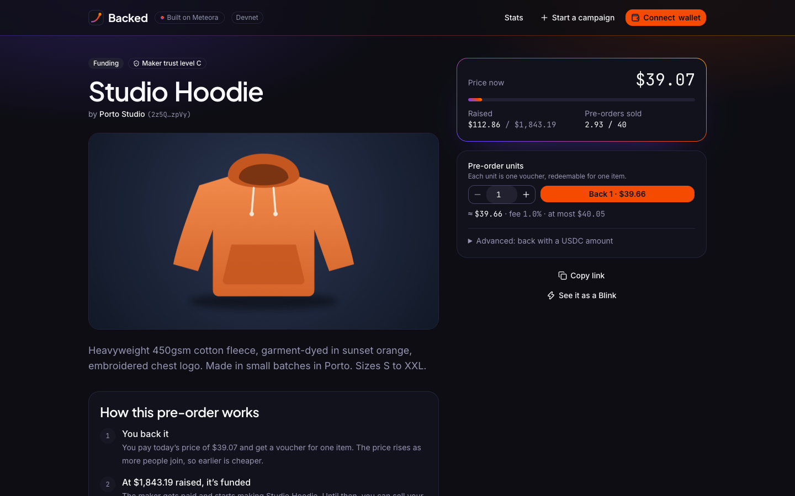
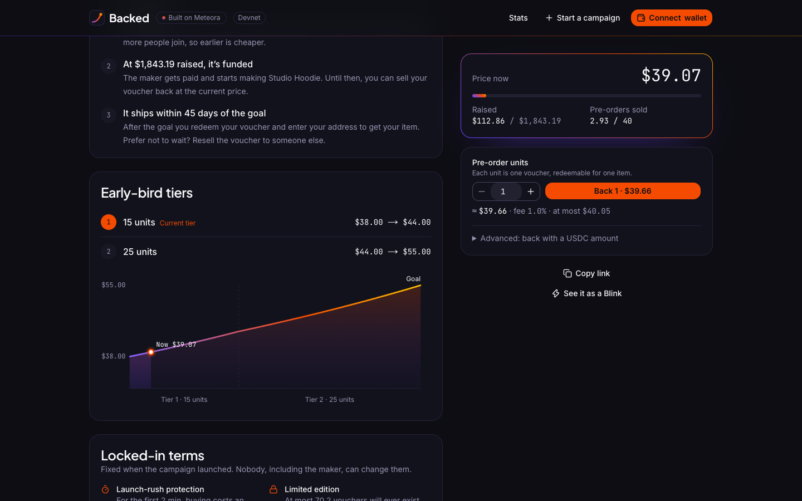
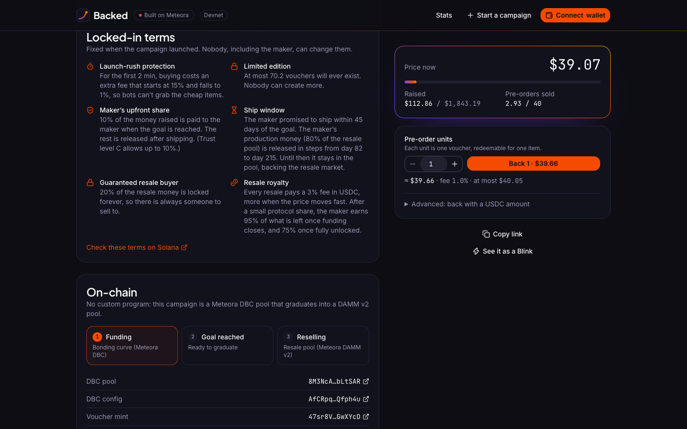
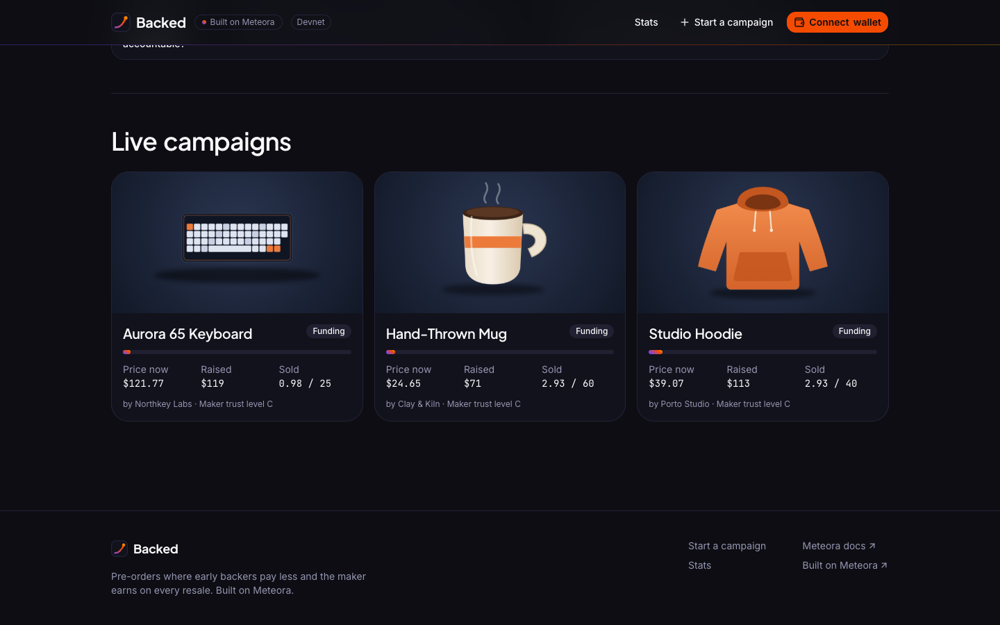
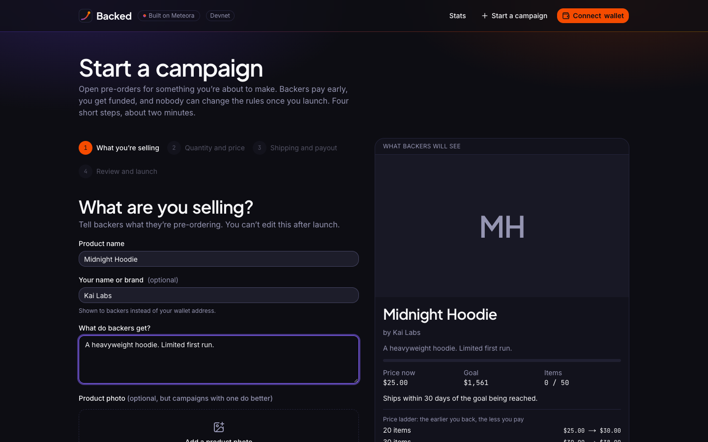
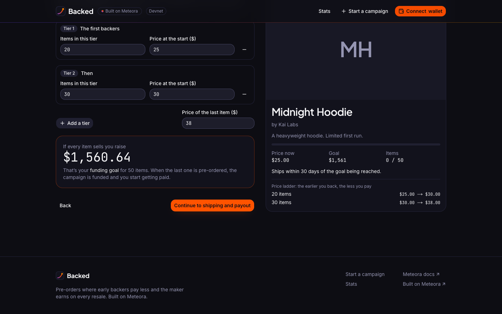
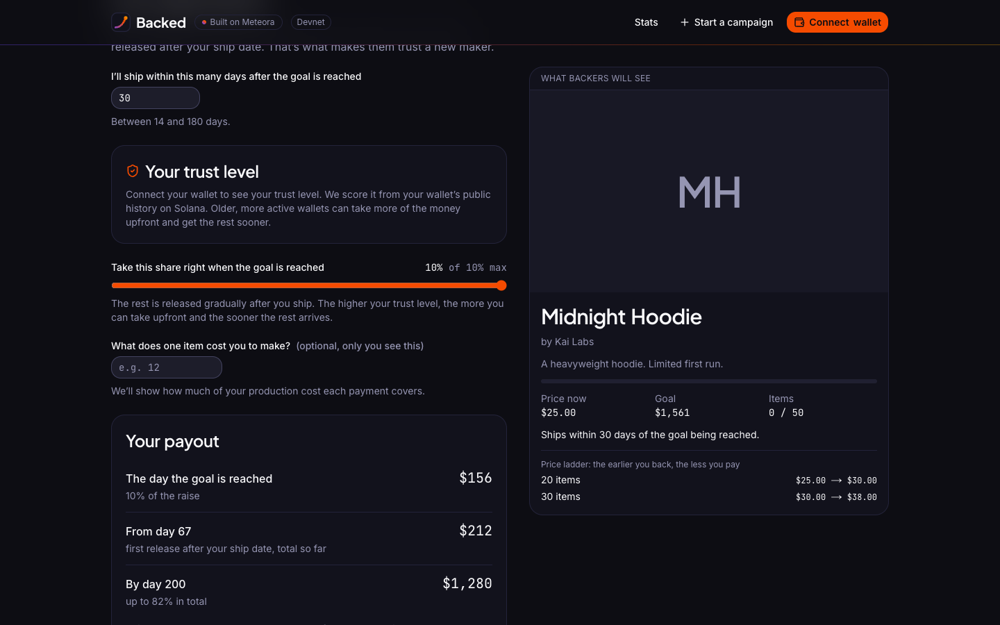
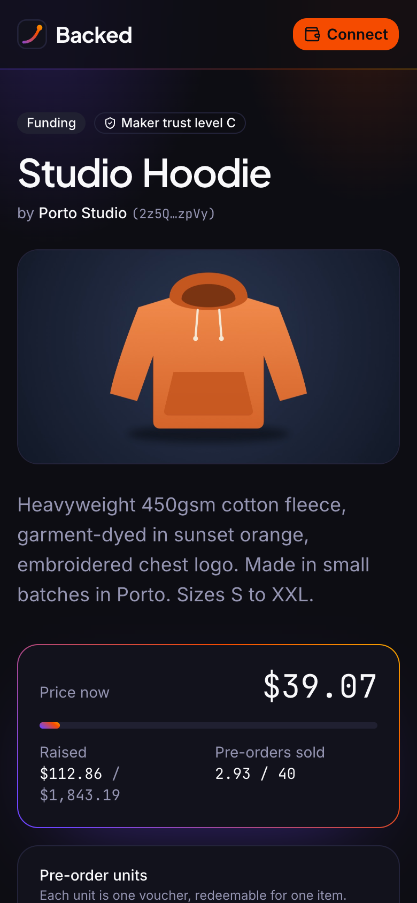

<div align="center">


# Backed

### Back it early. Pay less.

Pre-orders for real products, priced on a [Meteora](https://www.meteora.ag) Dynamic Bonding Curve.<br/>
Early backers pay less, the maker gets funded, and every resale pays the maker.

[](https://github.com/Don-Vicks/backed/actions/workflows/ci.yml)
[](https://backed.up.railway.app)
[](https://solana.com)
[](https://www.meteora.ag)
[](https://nextjs.org)
[](https://www.typescriptlang.org)


**[Live demo (devnet)](https://backed.up.railway.app)** · [Walkthrough](docs/walkthrough.md) · [How it uses Meteora](docs/dbc-mapping.md) · [Run it yourself](docs/replicate.md)



</div>

---

## The idea

A $30 pre-order sells out, then resells for $300, and the maker who made it gets nothing. Backed puts crowdfunding and resale on one curve:

1. **Early backers pay less.** A campaign's early-bird tiers are segments of a Meteora Dynamic Bonding Curve, so the price rises as units sell.
2. **Reaching the goal funds the maker.** The funding goal *is* the curve's graduation threshold. When it is met, the maker's upfront production budget is paid out automatically.
3. **Vouchers keep a market, and the maker keeps earning.** After graduation the same token trades on a DAMM v2 pool. A fifth of its liquidity is locked forever, the rest unlocks on the maker's ship-date schedule, and every resale pays the maker a royalty. Burn a voucher to claim the item.

**There is no custom program.** Every rule comes from Meteora's DBC config, DAMM v2 and standard SPL token burns.

## How it works

<div align="center">

</div>

## See it

<table>
  <tr>
    <td width="50%"><br/><sub><b>A campaign.</b> Live price, progress to the goal, and a one-click back button.</sub></td>
    <td width="50%"><br/><sub><b>The price curve.</b> Drawn from the real Dynamic Bonding Curve config.</sub></td>
  </tr>
  <tr>
    <td width="50%"><br/><sub><b>Locked-in terms.</b> Fixed at launch; anyone can verify them on Solana.</sub></td>
    <td width="50%"><br/><sub><b>Browse.</b> Every campaign, its price now, and how much it has raised.</sub></td>
  </tr>
</table>

**Creating a campaign takes four plain-language steps**, with a live preview of what backers will see:

<table>
  <tr>
    <td width="33%"><br/><sub><b>1.</b> Describe the product.</sub></td>
    <td width="33%"><br/><sub><b>2.</b> Set the tiers and prices.</sub></td>
    <td width="33%"><br/><sub><b>3.</b> Ship date, trust level and payout.</sub></td>
  </tr>
</table>

<div align="center">
<br/>
<sub>It works on a phone too.</sub>
</div>

For every step of one campaign, from launch to a shipped order, see the [walkthrough](docs/walkthrough.md).

## Why not just use crowdfunding?

| | Typical crowdfunding | Backed |
|---|---|---|
| **Price** | A fixed price per reward, and the early-bird slots run out. | The price rises smoothly, so earlier always means cheaper. |
| **Changed your mind?** | You're locked in once the campaign ends. | Sell your spot to anyone, any time. |
| **When it sells out** | Resellers keep the profit. The maker gets nothing. | The maker earns a cut of every resale. |
| **Is the maker accountable?** | The money usually arrives as soon as the campaign ends. | Most of it is released after the promised ship date. |

## Built on Meteora

Every setting the maker chooses becomes a field of a fixed on-chain config that nobody can change afterwards, not even the maker or the platform.

| The maker sets | Meteora does |
|---|---|
| Early-bird tiers | DBC `curve[]` segments |
| Funding goal | `migrationQuoteThreshold` |
| Upfront share of the raise | The migration fee, capped by the maker's trust tier |
| Launch-rush protection | `FeeSchedulerExponential`: 15% falling to 1% |
| Resale royalty | DAMM v2 `Customizable` pool fee |
| Resale floor | 20% of the resale liquidity locked permanently |
| Ship date | `creatorLiquidityVestingInfo` unlock schedule |
| Whole-unit buys | `swap2` with `ExactOut` and `PartialFill` |

The full mapping, with the reasoning behind each choice, is in [docs/dbc-mapping.md](docs/dbc-mapping.md).

## For judges

| Criterion | Where to look |
|---|---|
| **Depth of Meteora integration** | The product *is* a DBC config:<br>• tiers = `curve[]` segments<br>• goal = `migrationQuoteThreshold`<br>• upfront budget = migration fee<br>• anti-bot = fee scheduler<br>• production money = `creatorLiquidityVestingInfo`<br>• resale royalty = Customizable DAMM v2 pool<br>• backer floor = permanent locked liquidity<br>• whole units = `SwapMode.ExactOut`<br>• last buy = `PartialFill`<br>• referrals, creator and partner fee claims, pool and partner metadata<br>See [How Backed uses DBC](docs/dbc-mapping.md). |
| **Technical execution** | CI runs typecheck, lint, 193 unit tests and the build, then the full lifecycle on a validator loaded with the **mainnet** DBC and DAMM v2 binaries: once through the SDK ([`__tests__/localnet`](packages/core/src/__tests__/localnet)) and once clicked through the real app in Chromium ([`e2e/lifecycle.spec.ts`](apps/web/e2e/lifecycle.spec.ts)), from launch to a shipped order ([`ci.yml`](.github/workflows/ci.yml)).<br>Creation is maker-paid and the platform never signs. Every swap has a slippage minimum. Inputs pass zod schemas and an allowlist, and endpoints are rate-limited. Storage is SQLite with encrypted shipping data, and redemptions are memo-bound. |
| **Originality & taste** | Pre-order crowdfunding where resale pays the maker. The bonding curve is the early-bird pricing, graduation is "funded", and the DAMM v2 pool is a royalty-paying resale market with a permanent floor. The app wears Meteora's own design language (its v2 palette, type and gradient; see [brand.md](brand.md)) and draws each campaign's real DBC price curve. |
| **Impact** | Tokenized pre-orders as a new asset class: makers get funded without giving up resale, and early fans pay less. The economics are worked through in [Maker trust tier](docs/dbc-mapping.md#maker-trust-tier) and the payout panel. |
| **Traction** | Live on devnet at <https://backed.up.railway.app>, with a full lifecycle proven there ([Proof on devnet](docs/proof-on-devnet.md)). Mainnet needs only `NETWORK=mainnet`, a funded fee-claimer wallet and a real campaign ([Deploy](docs/deploy.md)). |

## Quick start

```bash
git clone https://github.com/Don-Vicks/backed.git
cd backed
corepack enable
pnpm install --frozen-lockfile
pnpm core:test        # 193 unit tests, no network needed
```

Needs Node 22.22 and pnpm 10. To try the live app, open <https://backed.up.railway.app>, switch your wallet to devnet and press **Get test USDC**. To run the app, the chain tests against a validator with the mainnet Meteora programs, or the browser suite, follow [docs/replicate.md](docs/replicate.md).

## Documentation

| Doc | What's in it |
|---|---|
| [Replicate and test it](docs/replicate.md) | Five levels, from a one-minute try to the full chain and browser suites |
| [Walkthrough](docs/walkthrough.md) | One campaign from creation to a shipped order, with screenshots |
| [How Backed uses Meteora](docs/dbc-mapping.md) | Every setting mapped to DBC and DAMM v2, plus the maker trust tier |
| [Architecture](docs/architecture.md) | Code layout and how wallet, graduation, Blinks and redemption work |
| [Commands](docs/commands.md) | Every script and command |
| [Configuration](docs/configuration.md) | Environment variables and API safeguards |
| [Localnet and CI](docs/localnet-and-ci.md) | A local validator with the mainnet programs, and the CI pipeline |
| [Deploy](docs/deploy.md) | Deploying to Railway |
| [Proof on devnet](docs/proof-on-devnet.md) | Real devnet transactions for a full lifecycle |
| [Brand](brand.md) | Palette, type and voice |

## Project structure

```text
apps/web            Next.js 16 app: pages and API routes (the API builds unsigned transactions)
  e2e/              Playwright: every feature in Chromium, on a local validator
packages/core       All Solana logic, shared by the scripts and the web server
scripts/localnet    Start, stop and dump a validator with the mainnet Meteora programs
docs/               Guides, the walkthrough and the images in this README
.github/workflows   CI: typecheck, lint, unit tests, build, chain suites and browser suite
```

## Tech stack

- **On-chain:** Meteora Dynamic Bonding Curve (`@meteora-ag/dynamic-bonding-curve-sdk`), Meteora DAMM v2 (`@meteora-ag/cp-amm-sdk`), SPL Token, `@solana/web3.js`
- **App:** Next.js 16, React 19, TypeScript, Tailwind 4, shadcn/ui, Solana wallet adapter
- **Data:** SQLite, with shipping details encrypted at rest
- **Tests:** Node's test runner, a local validator loaded with the mainnet programs, Playwright
- **Deploy:** Railway

## Known limits

- **Trust-minimized, not trustless.** (A delivery-conditioned payout is designed but not built: [docs/escrow-design.md](docs/escrow-design.md).) A maker can take the upfront share and never ship. The trust tier limits how much they can take upfront and how long the rest waits. Vesting is time-based: DBC and DAMM v2 cannot release liquidity when goods ship, so after the ship window a maker who disappears leaves backers a 20% permanent market floor, not a refund.
- **Exit ≠ refund.** Selling back before the goal pays the current curve price, which can be more or less than the price paid.
- **Single-server storage.** The store is SQLite on one volume, so the app runs as one replica. It is backed up hourly to the same volume (copy it off the machine too: [Deploy](docs/deploy.md#backups-and-alerts)) and failures alert a webhook, but there is no failover.
- **Shipping details are private only when the maker opts in.** With *private addresses* on, a backer's browser seals the address to a key only the maker's wallet can make, and Backed's servers never see it ([Architecture](docs/architecture.md#private-shipping-details)). Without it, details are encrypted at rest under a server key that decrypts them for the maker. Either way they are deleted once the order is marked shipped.
- **Maker sign-in is single-use, with a 30-minute session.** The server issues a one-time nonce, the maker signs it, and the signature buys a session token that is kept in memory, never in a cookie. A leaked signature cannot be replayed, but a stolen token works until it expires or the maker signs out.
- **Trust signals are simple.** Wallet age, activity and first funder can be gamed with aged wallets, and activity with a month of daily self-transfers. They are one input, shown openly, and not a verdict; an attestation (X OAuth or SAS) is an open decision.

## Roadmap

- A first real mainnet campaign with a real maker
- A Shopify plugin, so any store can offer pre-orders with a built-in resale market
- Maker attestation (X OAuth or SAS) as an extra trust signal
- Backer protection beyond the ship-date schedule: let backers who never receive their item hold back the maker's next unlock ([design note](docs/escrow-design.md))
- Onboarding for shoppers without a wallet: email sign-in with an embedded wallet, card checkout, and sponsored network fees

## Business model

Backed is the DBC **partner** on every campaign. It earns the partner half of curve trading fees (after Meteora's 20% protocol fee) and the fees on its 5% permanently locked share of each resale pool. `pnpm --filter @preorder/core platform:claim` collects both, and `/platform` shows them. Makers pay nothing upfront. First users are merch drops, indie hardware and game-key pre-orders, and hackathon teams. Later, a Shopify plugin so any store can offer pre-orders with a built-in resale market.

## License

[MIT](LICENSE)
