# Walkthrough: one campaign, start to finish

Every screenshot below comes from the real web app driven through a browser (Playwright, Chromium) with wallet-standard test wallets. It runs against a local validator loaded with the **mainnet** Meteora DBC, DAMM v2, Metaplex and Locker program binaries and every DAMM v2 migration config (`scripts/localnet/start.sh`). Each step is a real on-chain transaction. The only localnet-specific settings are a seconds-long vesting schedule (`VESTING_SCHEDULE_OVERRIDE`) so the unlock fits in a demo, and a trust fixture that gives the demo maker tier A.

Cast: a **maker**, three **backers** and a **referrer**. The product is a hoodie: 7 units, two early-bird tiers.

## 1. The maker describes the drop, and the page shows the DBC config it becomes

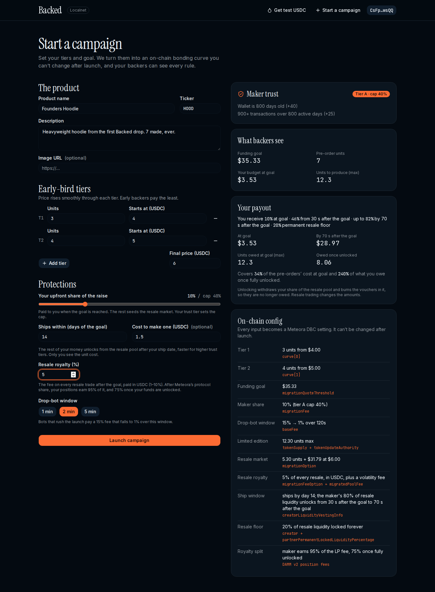

The maker sets the tiers (3 units from $4, 4 units from $5, final $6), their upfront share, a ship date, the unit cost and a resale royalty. The right-hand panels update as they type:
- **What backers see:** the goal is $35.33 for 7 units.
- **Your payout:** 10% at the goal, then up to 82% once the vesting schedule has run. It also shows how much of the production cost that covers.
- **On-chain config:** each input next to the DBC field it becomes (`curve[]`, `migrationQuoteThreshold`, `migrationFee`, `baseFee`, `tokenSupply`, `migrationFeeOption: Customizable`, `creatorLiquidityVestingInfo`, the permanent-lock split).

The maker's trust tier (A here) comes from wallet history and caps the upfront share.

## 2. Launch: the maker pays for and signs the campaign; the platform never signs

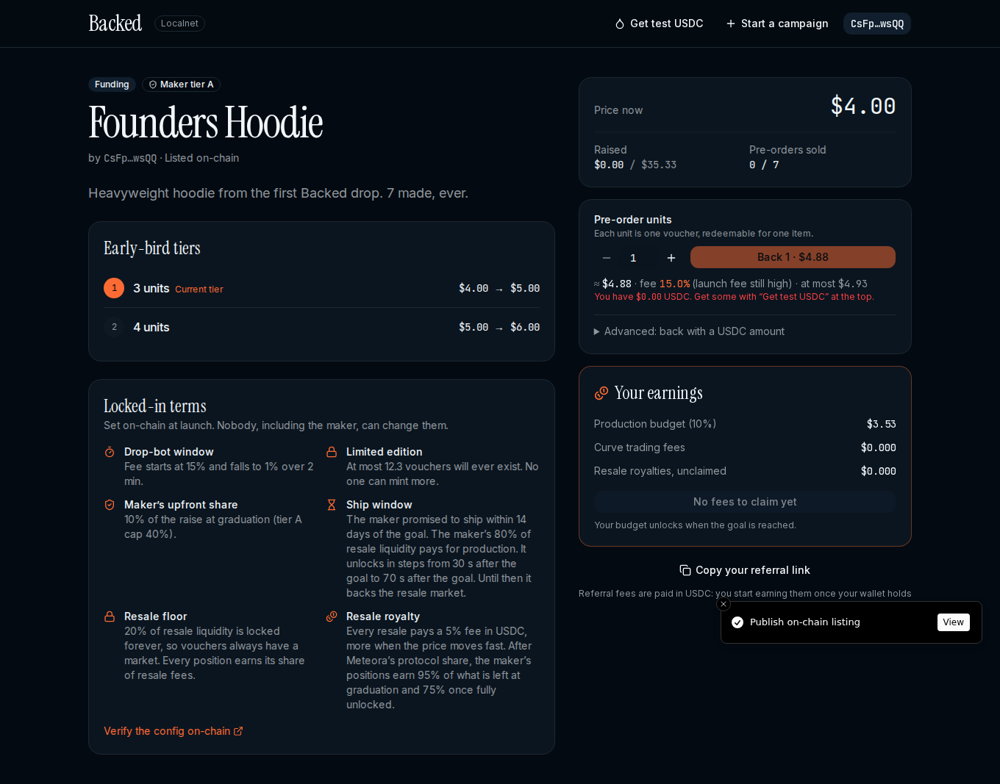

One click sends `createConfigAndPool`, or `createConfig` + `createPool` when a long name and 4 tiers would exceed 1232 bytes. The maker's wallet signs it, then signs the pool-metadata listing transaction ("Listed on-chain"). The "Locked-in terms" panel spells out the drop-bot fee (15% → 1% over 2 min), the limited supply, the upfront share, the ship window, the 20% permanent resale floor and the 5% royalty.

## 3. Backers buy whole units

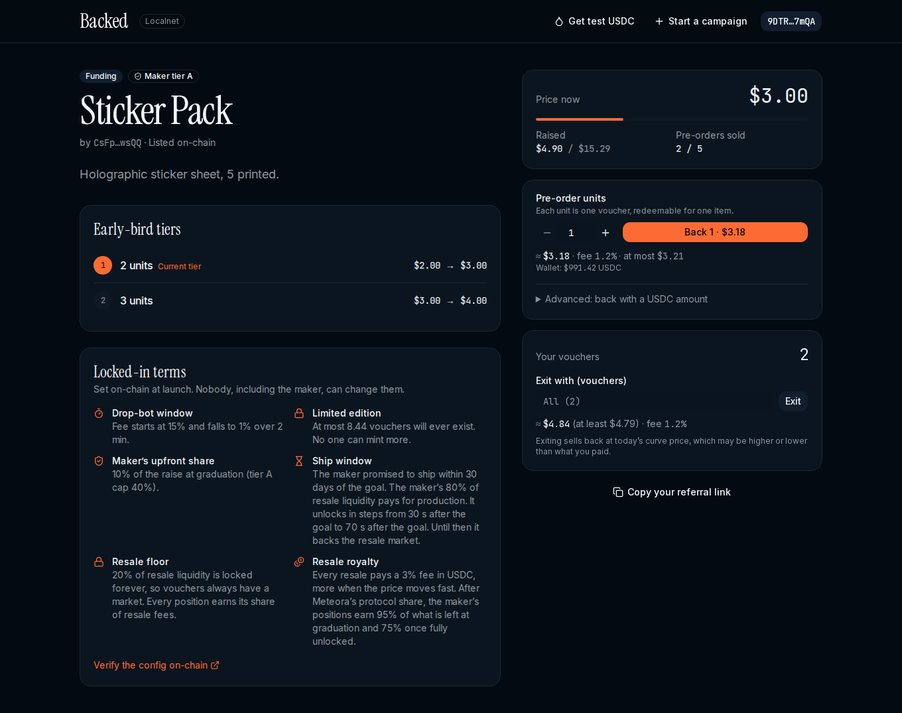

Backers choose a number of units, not dollars. Buys use DBC's `SwapMode.ExactOut` with a slippage-protected maximum taken from `swapQuote2`. The quote shows the fee while the drop-bot window is open. A backer who opened a referral link (`?ref=`) pays nothing extra, and the referrer gets DBC's referral cut: backer2's wallet rose by $0.02. Campaign numbers update as soon as the trade confirms.

## 4. Exit before the goal, at the curve price

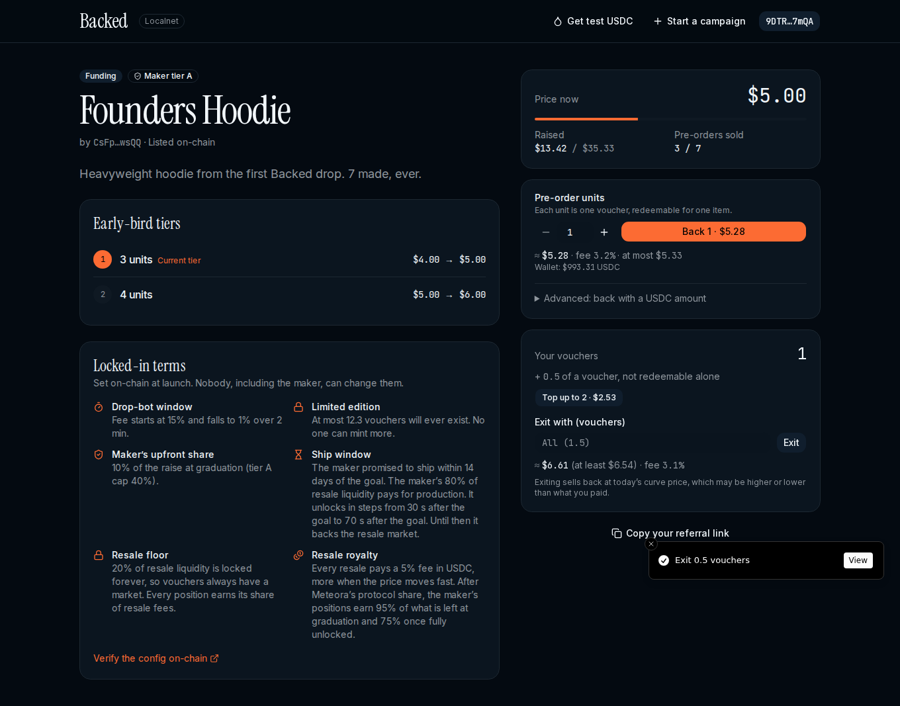

Before graduation a backer can sell any number of vouchers back along the curve (quoted, with a minimum out). Selling 0.5 left backer1 with 1.5 vouchers. The page explains that the half voucher can't be redeemed on its own and offers **Top up to 2** at the curve price.

## 5. The goal is reached

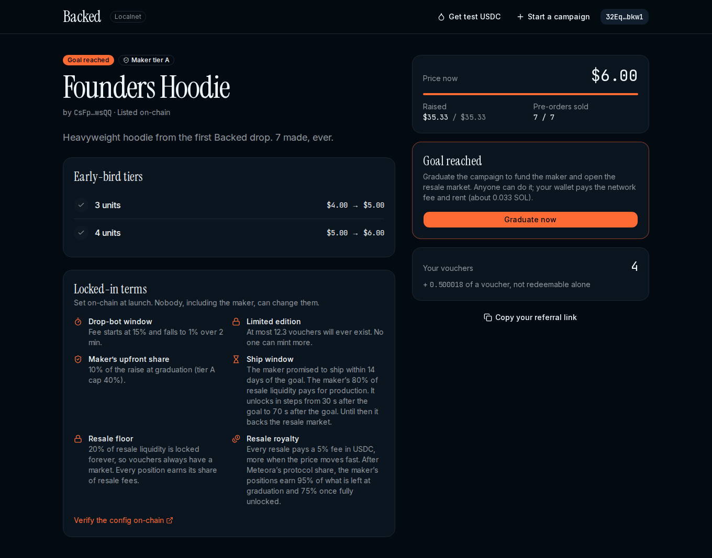

The last backer's buy is capped at what's left ("Back the last 4.5"), using `PartialFill` so it stops exactly at the goal: $35.33 / $35.33, 7 / 7. Anyone can graduate the campaign. The clicking wallet pays the migration (about 0.033 SOL), and Meteora's keeper may do it first on mainnet.

## 6. Graduation opens the resale market (DAMM v2, Customizable fee)

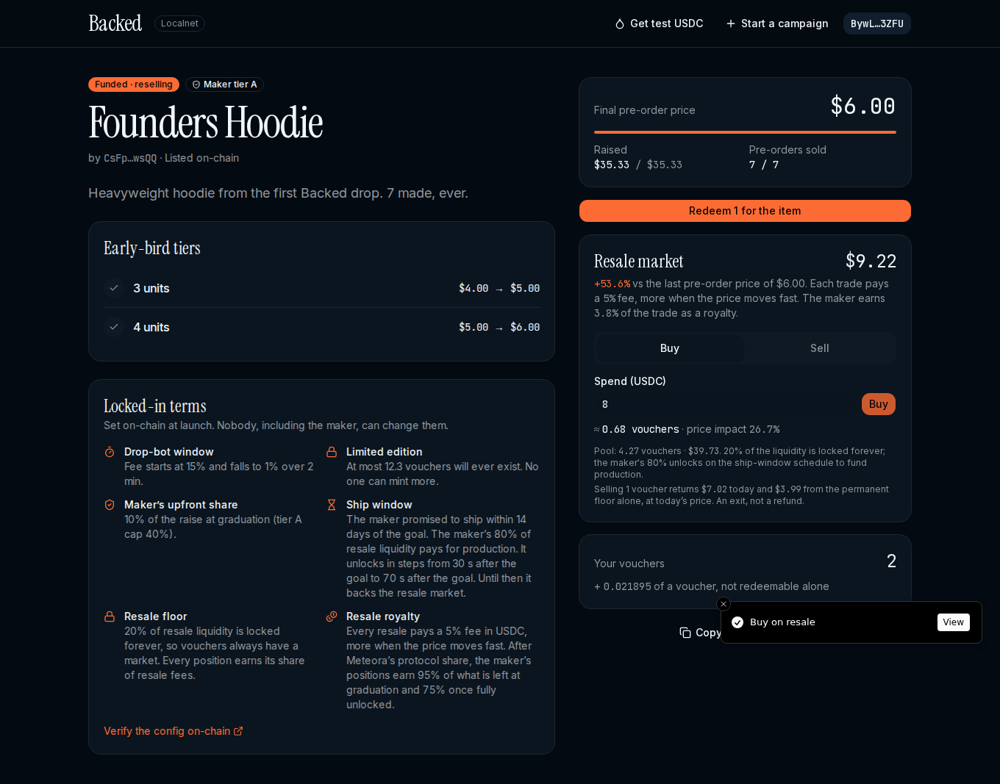

The pool migrates to DAMM v2 with the maker's 5% royalty. Vouchers trade with quoted slippage. The panel shows the premium over the last pre-order price, the pool depth, the share of liquidity that is locked forever, and the **backer floor**: what selling a voucher returns today, and what the permanent floor alone would return.

## 7. The maker's earnings, all read from chain

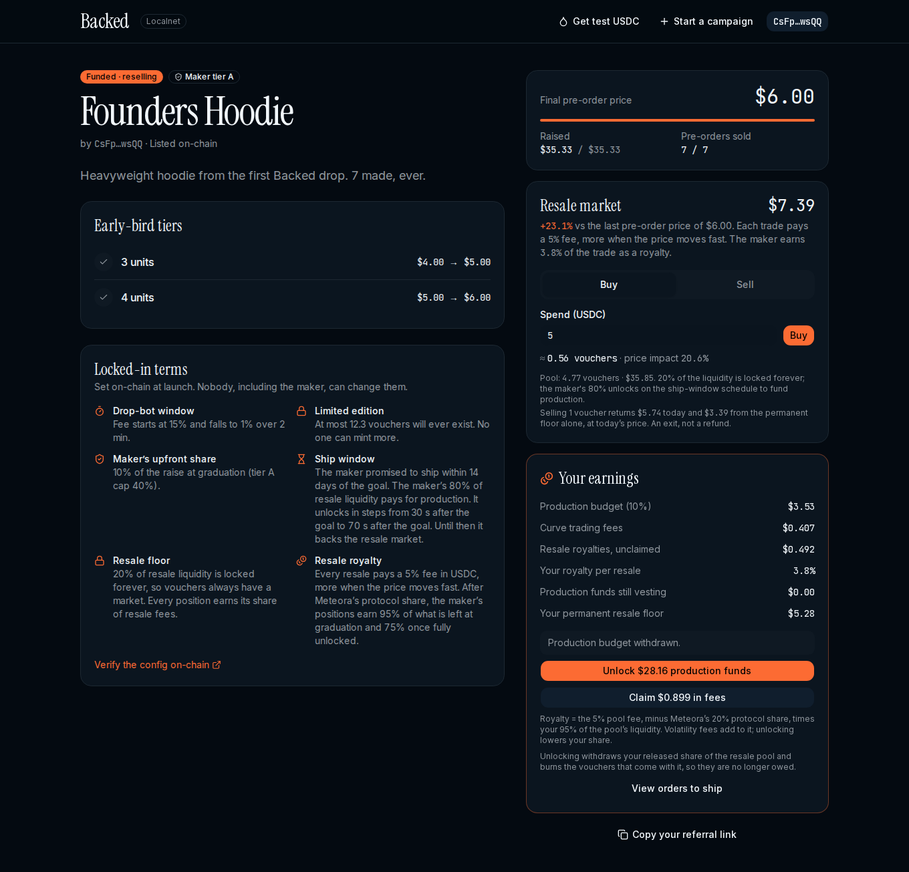

The maker sees:
- the production budget (the DBC migration fee, withdrawn with `creatorWithdrawMigrationFee`)
- curve trading fees
- unclaimed resale royalties
- their royalty per resale
- funds still vesting
- their permanent resale floor

**Claim** collects the DBC creator trading fees and every DAMM v2 position fee in one transaction.

## 8. Unlocking production funds: the ship-window vesting

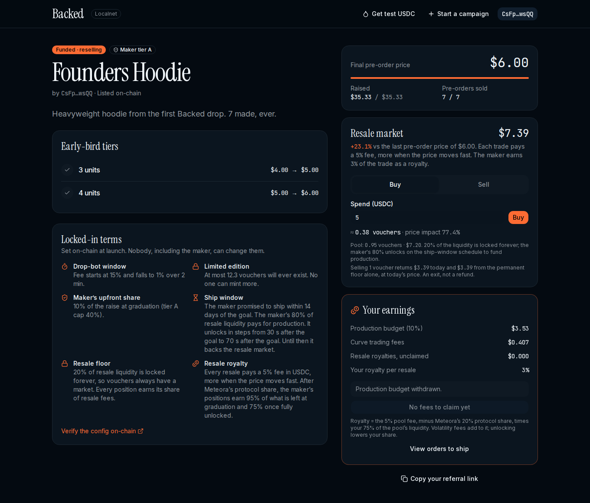

After the cliff, **Unlock production funds** removes the maker's released liquidity from the resale pool (`removeLiquidity`, with minimums from `getWithdrawQuote`). In the same transaction it burns every voucher that came out, so those vouchers are no longer owed. Before the cliff the program refuses the withdrawal. On mainnet the cliff is the ship date (at least 14, 30 or 60 days for tiers A, B and C). Here it was 30 seconds.

## 9. Redemption: shipping details bound to the burn

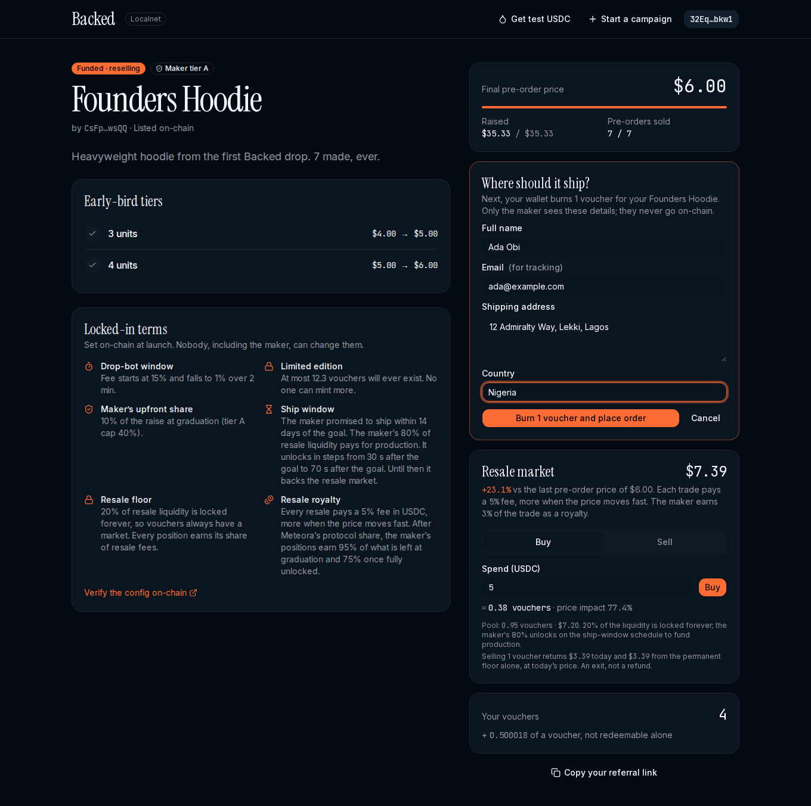

The backer enters shipping details first. The server stores them encrypted (AES-256-GCM) against a pending order id. It then returns a burn transaction carrying an SPL Memo with that id. Only a burn with the matching memo, made after graduation, by the owner's wallet and not by the maker's unlock, confirms the order. If the page closes in between, the order is recovered on the next visit.

## 10. The maker's orders

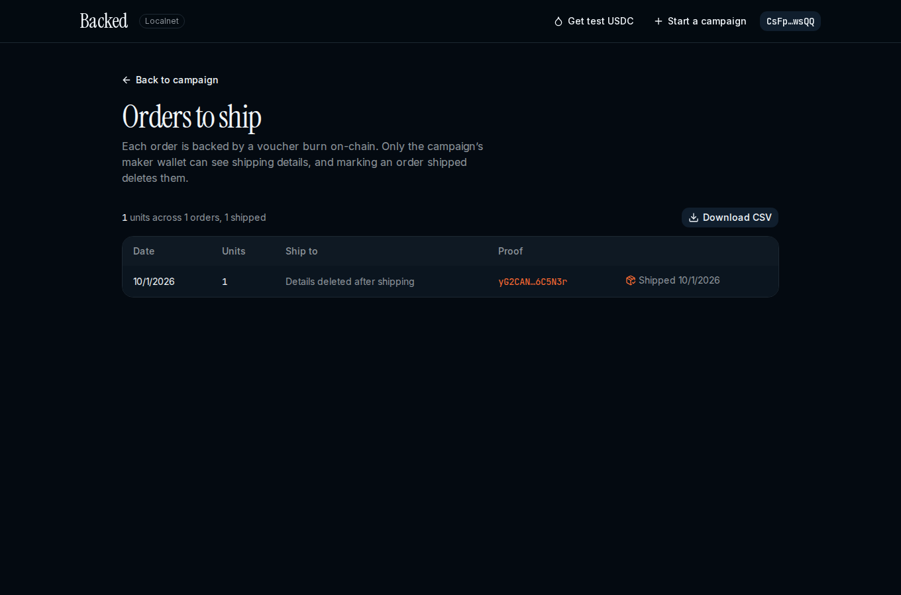

The maker signs a message that names the domain and expires after a few minutes. They see decrypted shipping details and can download a CSV that is safe from formula injection. **Mark shipped** deletes the shipping details and keeps the on-chain proof.

## 11. The platform's side

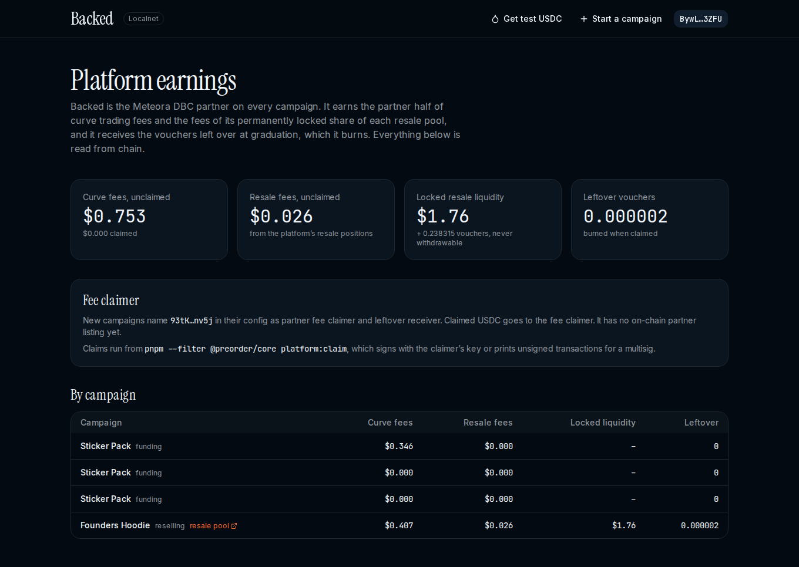

Backed is the DBC partner on every campaign. `/platform` reads what the partner is owed from chain:
- partner curve fees
- fees on the platform's 5% permanently locked resale positions
- locked liquidity
- leftover vouchers, which are burned when claimed

`pnpm --filter @preorder/core platform:claim` signs the claims, or prints unsigned transactions for a multisig.

## 12. Phones

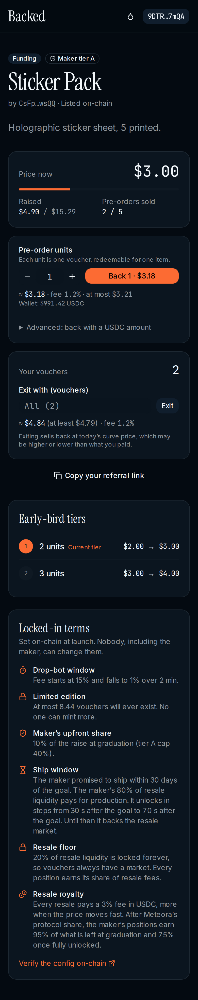

At 390px the title comes first, then the price and the Back panel, then the tiers and terms. No page scrolls sideways.

---

Reproduce it:

```bash
bash scripts/localnet/start.sh                      # validator with mainnet Meteora programs
PREORDER_ROOT=$(mktemp -d) pnpm core:seed:localnet   # wallets, mock USDC, .env.localnet
set -a; . $PREORDER_ROOT/.env.localnet; set +a
pnpm build && pnpm start                            # http://localhost:3000
LOCALNET=1 pnpm core:test:localnet                  # the same lifecycle as chain tests
```
